# CreditDecision: architecture

**One product for the wholesale credit lifecycle.** A borrower file goes in; a lending decision, a credit memo, a structure and a monitoring plan come out. The same engine then watches the live facility and runs it through collections and workout. Origination and collections share one rating model, one LGD model and one set of covenants, so the decision and the workout plan never disagree with each other.

Segment: Commercial Banking and Wholesale Credit (CIB): mid-market and large corporates, sponsor-backed borrowers, bilateral term loans and revolvers.

## 1. What problem it solves

From the research in [COMPETITORS.md](COMPETITORS.md):

- Credit teams spend more time **assembling** memos than **analysing** deals. Vendors now report memo prep falling from days to under 30 minutes (TD Credit Assist, S&P Credit Memo Builder, Aloan).
- The bottleneck is **data fragmentation and trust**, not drafting. GenAI drafts a narrative, but an approver still has to check every number against the spread (nCino, BCG, Moody's).
- Origination tools (nCino, Moody's Lending Suite, S&P) and collections tools (Newgen, Loxon, Botminds, Biz2X) are **separate products**. The covenants set at approval are re-keyed into monitoring, and the early-warning rules are disconnected from the rating model that priced the deal.

CreditDecision answers the last two directly:

1. **Every figure is computed, not generated.** Ratios, grade, PD, LGD, RWA, RAROC, covenants and the approver come from formulas in `casemath.credit`. The memo is rendered *from* the decision object, so it cannot contradict it. An LLM, if added, writes narrative around these numbers and is never the source of one.
2. **One engine from decision to recovery.** `decide()` emits the covenants and early-warning triggers; `monitor()` tests the live facility against them, re-rates on the same scorecard, stages it (IFRS 9, US classification, RBI SMA) and picks a collections strategy.

## 2. Target architecture

```mermaid
flowchart LR
  subgraph Channels
    RM[RM workbench] --- API[REST / batch API] --- CC[Credit committee pack]
  end
  subgraph Intake["1. Intake and data"]
    DOC[Financial statements<br/>OCR + spreading]
    ERP[Accounting / ERP feeds]
    MKT[Bureau, market data,<br/>external ratings]
    KYC[KYC, sanctions,<br/>adverse media]
  end
  subgraph Engine["2. Decision engine  (built: casemath.credit)"]
    SP[Spreading + pro forma<br/>analysis.py]
    RT[Rating scorecard<br/>rating.py]
    LGD[EAD, LGD, IRB capital,<br/>RAROC  analysis.py]
    POL[Policy checks +<br/>decision  decision.py]
    STR[Structure: covenants,<br/>amount, margin, approver]
  end
  subgraph Output["3. Outputs"]
    MEMO[Credit memo<br/>memo.py]
    NARR[LLM narrative layer<br/>optional, cites engine]
    WF[Approval workflow<br/>+ audit trail]
    BOOK[Booking / servicing<br/>e.g. Loan IQ]
  end
  subgraph Life["4. Monitoring and collections  (built: collections.py)"]
    COV[Covenant tests]
    EWS[Early-warning signals]
    STG[Re-rate, IFRS 9 stage,<br/>US class, SMA bucket, ECL]
    WO[Strategy + action plan:<br/>watchlist to recovery]
  end
  Channels --> Intake --> SP --> RT --> LGD --> POL --> STR
  STR --> MEMO --> NARR --> WF --> BOOK
  STR -- covenants + triggers --> COV
  BOOK -- servicing data, DPD,<br/>utilisation --> EWS
  COV --> STG
  EWS --> STG --> WO
  WO -- re-rating feeds next review --> RT
```



The middle of this picture, the decision engine and the monitoring and collections engine, is what this repository implements. Everything around it (OCR, data feeds, workflow UI, booking systems, LLM narrative) attaches through the documented inputs and outputs below.

### Layer by layer

| # | Layer | Responsibility | In this repo | Integration point |
|---|---|---|---|---|
| 1 | Intake | Get financials, request, collateral, KYC into a borrower file | JSON schema + validation (`model.py`) | OCR spreading (nCino, Moody's style), ERP/accounting APIs, KYC vendor |
| 2a | Spreading | Ratios per period plus a pro forma year with the new facility | `analysis.spread`, `spread_history`, `pro_forma`, `debt_capacity` | Swap in a bank's chart of accounts |
| 2b | Rating | 11-factor scorecard → 10-grade master scale → PD | `rating.rate`, `MASTER_SCALE` | Replace with the bank's validated PD model; keep the `Rating` interface |
| 2c | Loss and capital | EAD (CCF for revolvers), collateral haircuts → LGD, Basel IRB K and RWA, EL | `exposure_at_default`, `loss_given_default`, `irb_capital` | Bank LGD model, standardised approach |
| 2d | Returns | One-year RAROC and the margin that exactly meets the hurdle | `analysis.returns` | Funds transfer pricing curve |
| 2e | Policy and decision | Hard stops, soft exceptions, decision, approver, amount that fits | `decision.decide`, `BankPolicy` | Bank credit policy as config |
| 3 | Memo | 12-section committee memo in Markdown, from the decision object only | `memo.render_memo`, `render_summary` | Word/PDF export, LLM narrative with citations to engine fields |
| 4 | Monitoring and collections | Covenant tests, EWS, re-rating, staging, ECL, strategy, dated playbook | `collections.monitor`, `status_from_dict` | Core banking/servicing feeds (DPD, utilisation), news/event feeds |

## 3. Decision logic

```
borrower.json ─► borrower_from_dict ─► decide(borrower, BankPolicy)
                                         │
   spread_history(financials) ───────────┤  FY-1, FY0
   pro_forma(latest, request) ──► spread ┤  FY0 restated with the new facility
   rate(pro forma, history, industry, qualitative, kyc) ─► grade, PD
   exposure_at_default + loss_given_default ─► EAD, LGD
   returns(request, PD, LGD) ─► EL, RWA, capital, RAROC, required margin
   _checks(...) ─► hard stops + soft exceptions
                                         ▼
   Decline     any hard stop: open KYC flag, grade 9 (CCC) or worse, pro forma DSCR < 1.0x
   Refer       3+ exceptions, or grade at the edge of appetite (8)
   Approve w/c 1-2 exceptions (each becomes a named condition; approver moves up a level)
   Approve     everything passes
                                         ▼
   covenants (about 25% headroom to pro forma, capped by policy), amount that fits
   leverage/DSCR/hold limits, margin for hurdle, approver tier, conditions,
   risks + mitigants (from the three weakest factors), monitoring triggers
```

**Soft checks** (exceptions): leverage vs industry ceiling, DSCR ≥ 1.25x, ICR ≥ 3.0x, net-debt payback ≤ 7 years, tenor limit for grade, single-name hold limit for grade, RAROC ≥ hurdle, full collateral cover for grade 6 and worse.

**Approver tiers** (default `BankPolicy.authorities`): Regional Credit Officer (≤ 25M, grade ≤ 5) → Senior Credit Officer (≤ 100M, grade ≤ 6) → Chief Credit Officer (≤ 250M, grade ≤ 7) → Credit Committee. Any exception moves it up one tier.

### Rating scorecard

| Group | Factor | Weight | Weak → strong anchor |
|---|---|---|---|
| Financial 60% | Debt / EBITDA (pro forma) | 18% | 6.0x → 1.0x |
| | DSCR (pro forma) | 12% | 0.8x → 2.5x |
| | Interest cover (pro forma) | 10% | 1.0x → 8.0x |
| | EBITDA margin | 8% | 0% → 25% |
| | Scale (revenue, log) | 7% | 10M → 2B |
| | Current ratio | 5% | 0.8x → 2.0x |
| Business 40% | Management and governance | 12% | analyst 1-5 |
| | Market position | 10% | analyst 1-5 |
| | Industry risk | 10% | industry table 5 → 1 |
| | Financial reporting quality | 4% | analyst 1-5 |
| | Years in business | 4% | 2 → 20 years |

Overrides only ever notch **down**: EBITDA down more than 15% (−1), negative equity (−1), open KYC flags (−1), EBITDA ≤ 0 (floor at grade 8).

### Loss, capital and RAROC

- **EAD**: term loan = amount; revolver = drawn + 75% CCF × undrawn.
- **LGD**: collateral counts only for senior secured lending. Recoverable = value × (1 − haircut) (cash 0%, securities 15%, receivables 25%, real estate 30%, equipment 45%, inventory 50%, intangibles 80%). Secured share × 20% + unsecured share × 40% (senior) or 75% (subordinated).
- **Capital**: Basel IRB corporate formula with the 5 bp PD floor and 1-5 year maturity clamp; capital = RWA × 10.5%. Tested against the Basel reference value (PD 1%, LGD 45%, M 2.5 → RW 92.3%).
- **RAROC** = (drawn × (margin − funding spread) + fees − cost to serve − EL) × (1 − tax) / capital. The required margin is solved in closed form.

## 4. Monitoring and collections

`monitor(facility_status)` uses the same scorecard and LGD model as origination.

| Output | Rule |
|---|---|
| Covenant tests | Actual vs threshold, headroom as % of threshold; no EBITDA means leverage and cover tests fail |
| Early-warning signals | DPD bands, covenant breach or < 10% headroom, revenue −10%, EBITDA −20%, current ratio < 1, utilisation > 90% or +30 pts, rating migration ≥ 2 notches, 10 credit events (late reporting, auditor qualification, cross-default, legal action, fraud …) |
| Re-rating | Scorecard on current financials; DPD > 90 → grade 10 (default); any covenant breach → at least grade 7 |
| US classification | Pass / Special Mention / Substandard / Doubtful / Loss, driven by DPD, grade, signal severity and collateral cover |
| IFRS 9 stage | 3 if DPD > 90 or Doubtful/Loss; 2 if DPD > 30, migration ≥ 3 notches, or Special Mention/Substandard; else 1 |
| RBI bucket | Standard / SMA-0 / SMA-1 / SMA-2 / NPA |
| ECL | Stage 1: 12-month PD × LGD × EAD; stage 2: lifetime PD; stage 3: PD = 1 |
| Strategy | monitor → watchlist → remediate (waiver and reset, priced) → restructure (special assets, IBR, standstill, amend and extend) → recover (acceleration, enforcement, NPL sale vs enforce, write-off) |
| Action plan | Dated playbook per strategy with owner (RM, credit officer, special assets, legal, valuer, finance) |

## 5. Interfaces and how to launch

| Surface | Launch | Link |
|---|---|---|
| Web workbench (hosted) | Merge to `main`; Pages deploys automatically (enable once: Settings → Pages → Source: GitHub Actions) | `https://anshumantewary-pm.github.io/The-Consultant-s-Math/credit.html` |
| Web workbench (local) | `scripts/build_site.sh --serve` | http://localhost:8000/credit.html |
| CLI | `pip install -e ".[dev]"`, then the commands below | terminal |
| Python library | `from casemath.credit import ...` | notebook / service |

The web workbench (`web/credit.html`) installs the same wheel CI tested into Pyodide and calls `decide()` / `monitor()` in the browser. Example files are published next to it under `examples/`.


```bash
casemath industries                                     # industries and leverage ceilings
casemath credit examples/credit/northwind-industrial.json            # decision summary
casemath credit examples/credit/northwind-industrial.json --memo memo.md   # + memo file
casemath credit examples/credit/coastal-retail.json --json            # full decision + memo_markdown
casemath collect examples/credit/coastal-retail-q3-review.json        # monitoring + workout plan
```

```python
from casemath.credit import BankPolicy, borrower_from_dict, decide, render_memo, monitor, status_from_dict

decision = decide(borrower_from_dict(payload), BankPolicy(hurdle_raroc=0.15, min_dscr=1.3))
memo_md = render_memo(decision)
watch = monitor(status_from_dict(servicing_payload))
```

Every result is a frozen dataclass with `to_dict()`, so the JSON output is the API contract for a UI, a workflow engine or an LLM narrative layer.

## 6. Design rules (inherited from casemath)

1. Pure functions, no I/O inside the engine; the CLI does the reading and writing.
2. Validation at the edge with the field name in the message (`request.amortisation must be between 0 and 1`).
3. All policy thresholds live in `BankPolicy`; all reference data (industries, haircuts, master scale) are module-level tables. Nothing is hidden in code paths.
4. `casemath.credit` imports only `casemath.core`; `tests/test_architecture.py` enforces it.
5. The memo is a view of the decision, never a second source of truth.

## 7. Roadmap

See [feature-tracker.csv](feature-tracker.csv) for the full list with status. Next, in priority order:

1. **Document intake**: PDF/XLSX statement spreading into `Financials` with source cell references kept on each figure (matches nCino, Moody's, Aloan).
2. **LLM narrative layer** that writes the memo prose from `decision.to_dict()` with inline citations to engine fields (matches S&P Credit Memo Builder, nCino Banking Advisor), with a check that every number in the prose exists in the decision.
3. **Stress testing**: run `decide()` under EBITDA −20% and rates +200 bp using `casemath.analysis` sensitivity and Monte Carlo, which already work on any function.
4. **Approval workflow and audit trail**: decision versions, approver sign-off, exception register.
5. **Portfolio view**: run `monitor()` across a book; concentration by industry and grade; watchlist dashboard.
6. **Bank model plug-ins**: replace scorecard and LGD with the bank's validated models behind the same `Rating` and `CollateralCover` types (model risk governance, SR 11-7).
